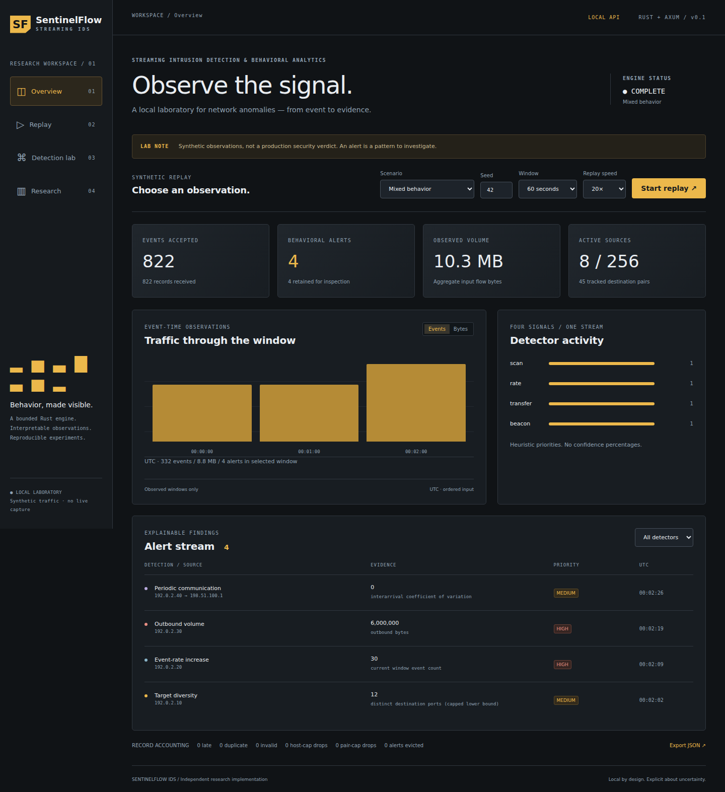

# SentinelFlow IDS

**Streaming Intrusion Detection & Behavioral Analytics Platform**

A local research laboratory that turns normalized flow events into bounded,
explainable observations. Rust performs streaming analysis; React/TypeScript
replays synthetic traffic through a real Axum API.

> Educational research software, not a production IDS. An anomaly is a reason
> to investigate, not proof of compromise. No live capture or offensive traffic
> is generated. All included data and screenshots are synthetic.

This is an independently rebuilt and extended project inspired by an earlier
team-led network security prototype at **ShellHacks 2025**. The original source
is unavailable. This repository contains new work, not recovered hackathon code,
historical experiments, a deployed system or institutional endorsement.



## Implemented

- Strict bounded JSONL ingestion with invalid, late, duplicate and capacity-drop counters.
- Event-time windows, bounded source/pair/ID state, TTL eviction and alert history.
- Four interpretable detectors: destination diversity, adaptive rate increase,
  outbound volume and periodic intervals (population coefficient of variation).
- Deterministic fixtures with separate truth; lazy large-workload generation.
- CLI configuration and JSON reports; loopback API; cancellable replay through a 64-event Tokio queue.
- Responsive dashboard: live metrics, interactive timeline, alert filtering/evidence,
  detector explanations, research tables and JSON downloads.
- Executable quality, threshold, window, throughput, memory and resilience experiments.
- Rust/frontend/browser tests, CI definition, real reports and dashboard screenshots.

## Install and run

Requirements: Rust stable supporting edition 2024 (tested with **1.99.1**),
**Node.js 24** and npm. Dependencies stay local to the project/toolchain.
Network access is needed for installation, not normal runtime. From the repo root:

```sh
cargo build --release --locked
npm ci --prefix frontend
npm run build --prefix frontend
./target/release/sentinelflow-ids serve 8787
```

Open **http://127.0.0.1:8787**. Select Mixed behavior and seed 42, then Start replay.
Overview shows live API measurements; Replay shows progress and queue pressure;
Detection lab explains rules; Research loads the included measured report.
Stop preserves a partial snapshot. A new run replaces the in-memory run.
There is no persistence or pause/resume. Ctrl+C stops the server.

Start the server from the repository root: it reads `frontend/dist` and
`reports/research.json`. Research is loaded at startup; restart after replacing it.
The frontend uses serialized polling with timeouts, not independent random data.

## CLI demonstration

Use a new output directory each time; outputs refuse ordinary overwrites:

```sh
./target/release/sentinelflow-ids --help
./target/release/sentinelflow-ids generate mixed 42 demo
./target/release/sentinelflow-ids replay demo/events.jsonl --output demo/report.json
./target/release/sentinelflow-ids workload 10000 42 workload.jsonl
./target/release/sentinelflow-ids replay workload.jsonl --max-events 10000
```

Mixed replay yields **822 received, 822 accepted, 4 alerts**, one per detector.
The committed [example](examples/mixed/report.json) is produced by the CLI;
input and separate truth are beside it. Workload is unlabeled stress input,
not a benign accuracy dataset, and can trigger alerts.

Replay writes JSON to stdout and a summary to stderr. Exit codes: `0` no record
or relevant state-loss condition; `2` usage/configuration/I/O failure; `3` report
produced with rejection, truncation or state loss. `--config config.json` accepts
partial Config JSON such as `{"window_ms":30000}`. Unknown fields and invalid
bounds fail. `--help` documents limits and timed replay. No input IP is contacted.

## Data and interpretation

Events contain `id`, UTC Unix `timestamp_ms`, `source`, `destination`,
`source_port`, `destination_port`, `protocol` (`TCP`, `UDP`, `ICMP`), `bytes`,
`packets`, `direction` (`outbound`, `inbound`, `internal`), optional `duration_ms`
and `tcp_flags`. See [JSONL examples](examples/mixed/events.jsonl). Unknown fields,
including truth labels, are rejected. Direction is supplied by the producer.

Alerts retain source, detector, event/window timestamps, observed statistic,
threshold, optional baseline, supporting-event count, severity, explanation and
caveat. Severity is a rule label, not a calibrated probability. Timeline buckets
contain observed counts/bytes/alerts; missing windows are not filled with zeros.
Only the latest 120 observed windows and configured alert FIFO are retained;
cumulative counters expose loss. Event timestamps are not verified incident times.

## Architecture

`src/event.rs`: validation; `ingestion.rs`: bounded reader; `engine.rs`: state and
rules; `generator.rs`: fixtures; `api.rs`: local queue/API; `main.rs`: CLI;
`src/bin/research.rs`: experiments; `frontend/`: dashboard; `tests/`: integration.

Serde provides typed JSON, Tokio bounded async tasks, Axum routing and tower-http
static assets. React supports interaction. No Python implementation, trained ML,
cloud runtime, database, analytics SDK or external font requests are included.
See [architecture](docs/architecture.md), [detection methods](docs/detection-methodology.md)
and [benchmark methods](docs/benchmark-methodology.md).

## Research and tests

[Measured results](docs/research-results.md) derive from
[`reports/research.json`](reports/research.json), including raw repeated trials.
Defaults yield 40 TP, 5 FP, 0 FN and 695 TN on the defined synthetic units.
Scheduled benign traffic causes beacon false positives by design. These figures
show fixture behavior, **not real-world intrusion-detection accuracy**. Seeds vary
background, attack shapes are known and there is no held-out traffic corpus.

Run into a new output directory:

```sh
cargo run --release --locked --bin research -- reports/reproduced
```

For dashboard use, deliberately copy the result to `reports/research.json` and
restart. Timing/RSS vary with machine and load.

```sh
cargo fmt --check
cargo clippy --locked --all-targets -- -D warnings
cargo test --locked
npm run format:check --prefix frontend
npm run typecheck --prefix frontend
npm test --prefix frontend
npm run build --prefix frontend
cd frontend
npx playwright install chromium
npm run e2e
```

E2E starts the release backend; port 8787 must be free. It checks real replay/stop,
API/UI agreement, evidence, downloads and mobile width, and writes actual captures
to `docs/screenshots/`. An existing compatible browser can be supplied through
`PLAYWRIGHT_CHROMIUM_EXECUTABLE`. See [validation](docs/validation.md) for actual
outcomes. GitHub Actions is configured; no hosted CI run is claimed.

## Safety, limits and next steps

Keep the unauthenticated server on loopback. Host/header checks and request caps
are defense in depth, not authorization. Files open read-only, but CLI symlinks
are followed and reading may affect access time. Reports can contain supplied IPs
and identifiers. This is not an evidence-acquisition tool. Read [SECURITY.md](SECURITY.md).

Late events are dropped. Capacity caps, window boundaries, duplicate-cache eviction
and limited history change outcomes. Baseline poisoning, jittered periodic traffic,
slow/distributed scans and small transfers can evade rules; benign services can
alert. See [limitations](docs/limitations.md).

Roadmap (not implemented): independent authorized real-traffic evaluation;
bounded lateness buffering; persistent run history; authenticated multi-user
operation; provenance-aware PCAP/flow-export adapters.

To publish later, create an empty `sentinelflow-ids` GitHub repository and upload
this directory's contents, including `.github/`, `Cargo.lock` and the frontend
lockfile. Exclude build/dependency folders using `.gitignore`. Nothing is
published automatically. MIT license.
